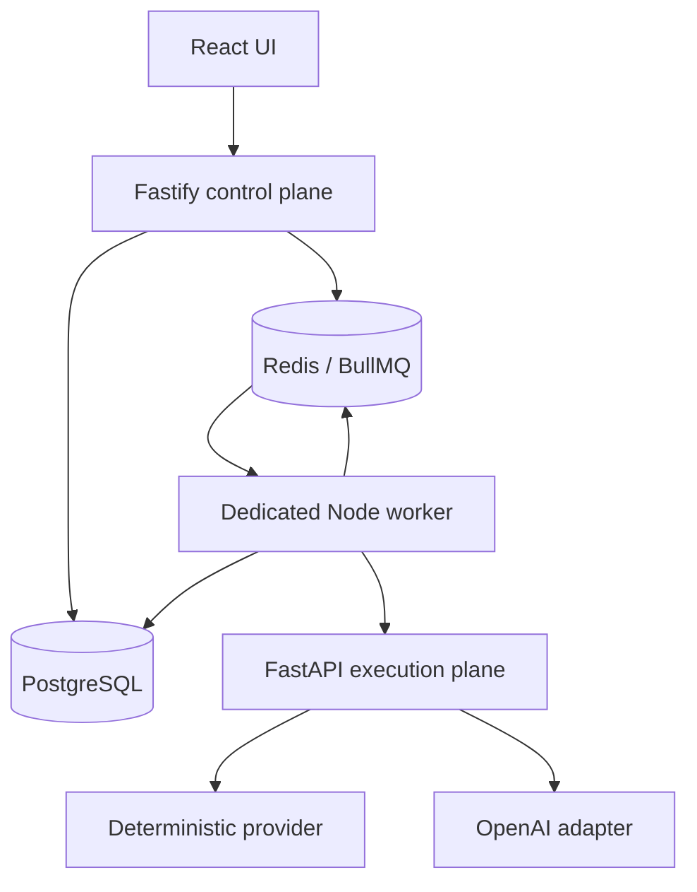

# AgentOps Studio Architecture

## Milestone 3 system

## Ownership boundaries

The web client edits/version workflows and prompts, launches runs/evaluations, polls durable state, and presents traces and approvals. It never receives provider credentials.

The API validates project-scoped resources, persists commands, enqueues minimal identifiers, and returns. In production it does not own a long-running execution promise. PostgreSQL is authoritative; Redis contains delivery state, not workflow graphs or secrets.

The worker consumes run and evaluation queues, reloads parent relationships from PostgreSQL, runs the shared `RunExecutor`, checkpoints NodeRuns/traces, calls Python only for LLM nodes, and schedules retries/resumes. Python remains provider-only.

## Durable lifecycle

A run transitions `QUEUED -> RUNNING -> COMPLETED|FAILED|CANCELLED`, or `RUNNING -> WAITING_FOR_APPROVAL -> QUEUED -> RUNNING`. NodeRuns support `PENDING`, `RUNNING`, `WAITING`, `COMPLETED`, `FAILED`, `SKIPPED`, and `CANCELLED`.

BullMQ uses three attempts with 1-second exponential backoff. Only transport, timeout, HTTP 429, and provider/server 5xx failures are transient. Invalid graphs/configuration and human rejection are permanent. Provider calls time out after 30 seconds; execution checks a 120-second deadline between nodes. Queue locks are renewed and stalled jobs may be recovered twice.

`(run_id,node_id)` is unique. On duplicate delivery the executor uses completed NodeRun output as the next value instead of rerunning the node. Worker startup re-enqueues `QUEUED`/`RUNNING` runs with deterministic recovery identities. BullMQ also recovers stalled active jobs. The ambiguous provider-response crash window is documented rather than falsely claiming exactly-once external calls.

## Human approval

A HUMAN_APPROVAL node creates one ApprovalRequest per NodeRun, changes the node to `WAITING` and run to `WAITING_FOR_APPROVAL`, writes trace events, and returns from the job. Approval persists the demo reviewer decision and queues a resume. Rejection terminates as `CANCELLED` with `HUMAN_REJECTED`; no rejection branch exists in Milestone 3.

## Cancellation

Queued and waiting runs are cancelled immediately and queued work is removed where possible. Running runs store a cancellation request; the worker stops at the next node boundary. Terminal cancellation calls are idempotent. All access first validates project/workflow/run or project/approval ancestry.

## Evaluation lifecycle

Evaluation orchestration is a BullMQ job. It creates normal WorkflowRuns, queues them on the same run queue, observes their persisted terminal status, evaluates the output, and aggregates metrics. It therefore survives API restart and does not create a second execution engine.

## Deployment boundary

Compose exposes only web `3000` and API `3001`. Worker, AI `8000`, PostgreSQL `5432`, and Redis `6379` remain on the private Compose network. The Azure VM NSG should expose only 3000/3001 publicly and SSH 22 from the operator IP.

## Explicitly out of scope

Conditions, transforms, HTTP requests/tools, branching DAGs, retrieval/RAG, agent loops, and production authentication/hardening.
