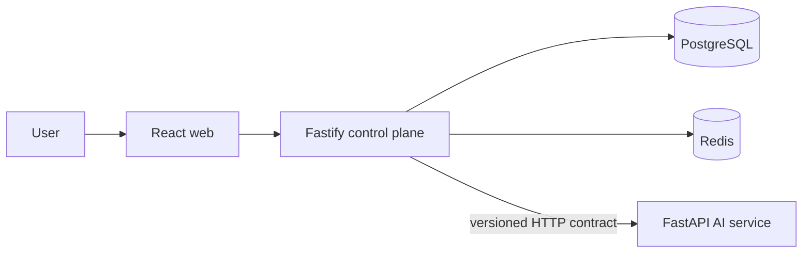

# Architecture

## System context

The web application is the product interface. The Node.js API owns product state and orchestration coordination. The Python service owns model-provider integration and AI-specific execution. PostgreSQL is durable storage; Redis is reserved for transient coordination and queueing.

## Boundaries

- Browser traffic terminates at the control plane. Provider secrets never enter browser bundles.
- `packages/contracts` contains versioned, runtime-validated service contracts.
- The Node API calls Python through a typed client with explicit timeouts and failure mapping.
- Database migrations are append-only SQL in `apps/api/migrations`.

## Implemented in Milestone 0

Health/readiness endpoints, dashboard shell, service-to-service health client, PostgreSQL/Redis infrastructure, initial migration, CI, and quality tooling.

## Planned

Workflow graph/version persistence, real provider execution, traces, evaluations, approvals, authorization, queues, and OpenTelemetry are intentionally deferred to later vertical slices.
