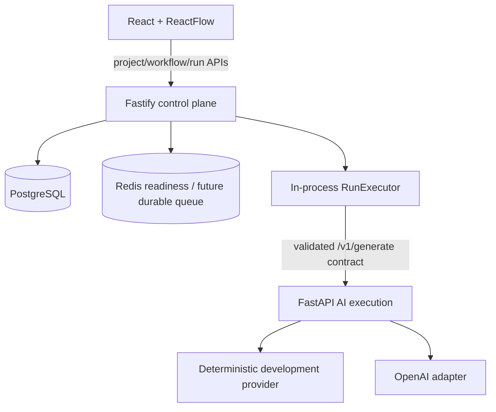

# AgentOps Studio Architecture

## Milestone 1 system

## Ownership boundaries

### Web

- Project and workflow navigation
- ReactFlow node placement and edges
- PROMPT and LLM configuration
- Save, validate, version, and run actions
- Polling terminal run state
- Result and trace timeline rendering

The browser calls only the Node API. It never receives provider credentials or chooses an arbitrary Python URL.

### Node control plane

- Project-scoped resource access
- Strict Zod graph and AI-contract validation
- Kahn topological ordering and explicit cycle detection
- Mutable drafts and immutable versions
- Run, NodeRun, and TraceEvent persistence
- Controlled prompt interpolation
- Asynchronous node coordination and safe failure propagation
- Structured logs with project/workflow/version/run/node identifiers

### Python execution plane

- Pydantic request/response validation
- Provider selection from server environment
- Deterministic development generation
- OpenAI-specific request/response translation
- Safe provider error boundary

Python owns no project, workflow, run, or trace persistence.

## Data model

- `projects`: isolation parent
- `workflows`: metadata plus mutable draft graph
- `workflow_versions`: immutable graph snapshots with per-workflow version numbers
- `runs`: scoped execution state, runtime input, final output, and safe errors
- `node_runs`: ordered node inputs, outputs, timing, state, and safe errors
- `trace_events`: persistent lifecycle/model events

Foreign keys cascade from project/workflow/run where child data has no independent meaning. A workflow version referenced by a run is protected from deletion.

## Validation and execution

The accepted Milestone 1 graph contains exactly one INPUT, at least one PROMPT, exactly one LLM, and exactly one OUTPUT. Every non-INPUT node has one incoming edge; every non-OUTPUT node has one outgoing edge. References, duplicates, self-edges, connectivity, reachability, configuration, and cycles are validated.

Kahn's algorithm uses a sorted zero-indegree queue to produce deterministic order. A graph is cyclic when fewer nodes are emitted than exist.

`POST /runs` validates the chosen immutable version, persists QUEUED and RUN_CREATED, returns 202, then schedules the isolated executor. The executor persists RUNNING and node transitions, calls Python only for the LLM operation, persists final output, and terminates as COMPLETED or FAILED.

## Current reliability boundary

The executor is isolated in code but runs inside the API process. Redis-backed durable queueing, retries, leasing, and interrupted-run recovery are planned hardening, not Milestone 1 behavior.

## Security

- Strict external validation on both Node and Python boundaries
- Project/workflow parent scope on every nested lookup
- No provider key, Authorization header, or database credential in traces
- No arbitrary template expressions; only controlled variables
- Safe provider errors rather than raw stack traces
- Azure deployment uses GitHub OIDC and VM-scoped permissions
