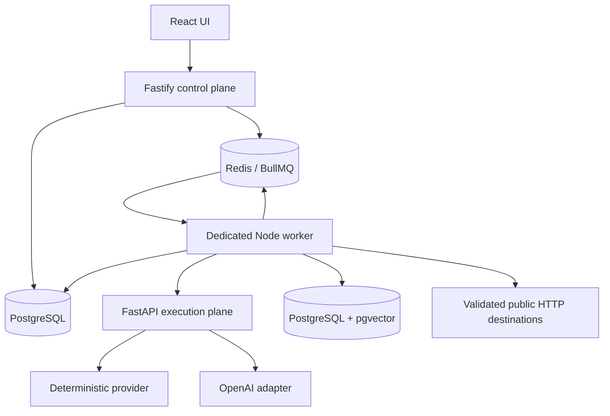

# AgentOps Studio Architecture

## Milestone 6 system

## Ownership boundaries

The web client edits/version workflows and prompts, launches runs/evaluations, polls durable state, and presents traces and approvals. It never receives provider credentials.

The API validates project-scoped resources, persists commands, enqueues minimal identifiers, and returns. In production it does not own a long-running execution promise. PostgreSQL is authoritative; Redis contains delivery state, not workflow graphs or secrets.

The worker consumes run, evaluation, and knowledge-ingestion queues, reloads authoritative state from PostgreSQL, runs the shared `RunExecutor`, checkpoints NodeRuns/traces, and schedules retries/resumes. `AGENT` is a normal executor node; it does not create another workflow engine. Python remains provider-only for generation, embeddings, and one strict structured agent action at a time.

## Controlled agents and Tool Registry

AgentExecution owns bounded status and counters; AgentStep stores a structured action and concise summary; ToolCall stores validated safe arguments, approval linkage, and result. Unique `(agent_execution_id, step_number)` and one ToolCall per step make duplicate queue delivery resume from checkpoints. Completed calls are reused. External HTTP has an unavoidable crash window between a remote side effect and local checkpoint, so exactly-once effects are not claimed.

The Tool Registry exposes only `retrieval`, `http_request`, and `transform`. These adapters reuse M5 project-scoped vector search, M4 SSRF/DNS/redirect/timeout/size/secret/retry controls, and M4 structured transforms. No executable code or arbitrary model-selected name is accepted. Tool observations and retrieved text are explicitly treated as untrusted data.

Agent actions are `TOOL_CALL` or `FINAL` JSON validated at both the Python and Node boundaries. The platform does not request or persist hidden reasoning. Hard maximums are 10 steps, 10 tool calls, and 120 seconds of active agent time. Provider-reported usage supports a token budget; missing token metadata is recorded honestly rather than estimated.

Sensitive calls reuse ApprovalRequest with type `AGENT_TOOL`. The worker persists the proposed call and redacted context, marks the node/run waiting, and exits. Approval or rejection queues a resume. Rejection is a structured observation and may lead to a fallback within the remaining budget. Cancellation updates the run, agent, active step, call, and approval state.

## Knowledge ingestion and vector storage

KnowledgeSource, KnowledgeDocument, KnowledgeChunk, and KnowledgeChunkEmbedding are project-scoped PostgreSQL records. Documents move `UPLOADED -> PROCESSING -> READY|FAILED`. The ingestion worker extracts ordered TXT/PDF/DOCX content, chunks deterministically with overlap and page metadata, obtains provider-neutral embeddings, and atomically replaces the document's chunks and vectors. Duplicate SHA-256 uploads return the existing record, completed jobs are idempotent, and incompatible provider/model/dimension writes are rejected.

Embeddings use the existing PostgreSQL service with the `vector` extension. Search uses cosine distance converted explicitly to `cosine_similarity`; it never mixes source models or crosses project/source boundaries. Vector values are not exposed by APIs or traces.

## Retrieval, grounding, and citations

RETRIEVAL is a normal durable workflow node, not a second executor. It reads an allowlisted dot path, verifies project ancestry, embeds with the Knowledge Source model, and returns ranked chunk provenance plus deterministic controlled context. Traces record safe query length, result count, latency, provider/model, ranks, and source identifiers without full confidential content.

PROMPT accepts `retrieval_context` as an explicit variable. The renderer clearly labels retrieved text as untrusted data and separates it from workflow instructions. This reduces but cannot eliminate indirect prompt injection. LLM citations using source numbers or chunk IDs are resolved only against the retrieved set; invalid citations fail the node, while valid retrieved/cited provenance is persisted.

Retrieval Hit@K, Recall@K, MRR, and citation checks run in the existing evaluation framework and reuse ordinary durable WorkflowRuns.

## Branching and deterministic tools

The graph is an acyclic, single-parent DAG. INPUT remains unique; multiple OUTPUT terminals are allowed. CONDITION has exactly one `true` and one `false` edge. Other edges cannot carry branch metadata. Complex joins are rejected in M4. At runtime the executor follows only the selected edge and persists `SKIPPED` NodeRuns for every node in the rejected subtree.

CONDITION reads a dot path and applies an allowlisted operator. TRANSFORM recursively builds JSON-compatible output using constants and controlled placeholders. Neither accepts executable code. HTTP_REQUEST is a worker-only capability: it accepts a strictly typed configuration, resolves and validates DNS, blocks loopback/link-local/private/metadata/internal targets, permits only HTTP(S), manually validates up to three same-origin redirects, uses a 10-second default/30-second maximum timeout, and streams at most 1 MiB by default/5 MiB maximum.

Workflow graphs contain secret reference names only. `TOOL_SECRETS_JSON` maps project IDs and reference names to values inside the worker environment. Authorization, cookies, API keys, and Set-Cookie are never persisted in normalized responses or traces.

## Durable lifecycle

A run transitions `QUEUED -> RUNNING -> COMPLETED|FAILED|CANCELLED`, or `RUNNING -> WAITING_FOR_APPROVAL -> QUEUED -> RUNNING`. NodeRuns support `PENDING`, `RUNNING`, `WAITING`, `COMPLETED`, `FAILED`, `SKIPPED`, and `CANCELLED`.

BullMQ uses three attempts with 1-second exponential backoff. Only transport, timeout, HTTP 429, and provider/server 5xx failures are transient. External HTTP GET can retry; POST/PUT/PATCH require an explicit retry flag and deterministic idempotency-key header. Invalid graphs/configuration, SSRF blocks, and human rejection are permanent. Provider calls time out after 30 seconds; execution checks a 120-second deadline between nodes. Queue locks are renewed and stalled jobs may be recovered twice.

`(run_id,node_id)` is unique. On duplicate delivery the executor uses completed NodeRun output as the next value instead of rerunning the node. Worker startup re-enqueues `QUEUED`/`RUNNING` runs with deterministic recovery identities. BullMQ also recovers stalled active jobs. The ambiguous provider-response crash window is documented rather than falsely claiming exactly-once external calls.

## Human approval

A HUMAN_APPROVAL node creates one ApprovalRequest per NodeRun, changes the node to `WAITING` and run to `WAITING_FOR_APPROVAL`, writes trace events, and returns from the job. Approval persists the demo reviewer decision and queues a resume. Rejection terminates as `CANCELLED` with `HUMAN_REJECTED`; no rejection branch exists in Milestone 3.

## Cancellation

Queued and waiting runs are cancelled immediately and queued work is removed where possible. Running runs store a cancellation request; the worker stops at the next node boundary. Terminal cancellation calls are idempotent. All access first validates project/workflow/run or project/approval ancestry.

## Evaluation lifecycle

Evaluation orchestration is a BullMQ job. It creates normal WorkflowRuns, queues them on the same run queue, observes their persisted terminal status, evaluates the output, and aggregates metrics. It therefore survives API restart and does not create a second execution engine.

## Deployment boundary

Compose exposes only web `3000` and API `3001`. Worker, AI `8000`, PostgreSQL `5432`, and Redis `6379` remain on the private Compose network. The Azure VM NSG should expose only 3000/3001 publicly and SSH 22 from the operator IP.

## Explicitly out of scope

Unrestricted autonomy, recursive or multi-agent systems, arbitrary tools, shell/code/filesystem/browser execution, complex joins, billing, and production authentication/hardening.
