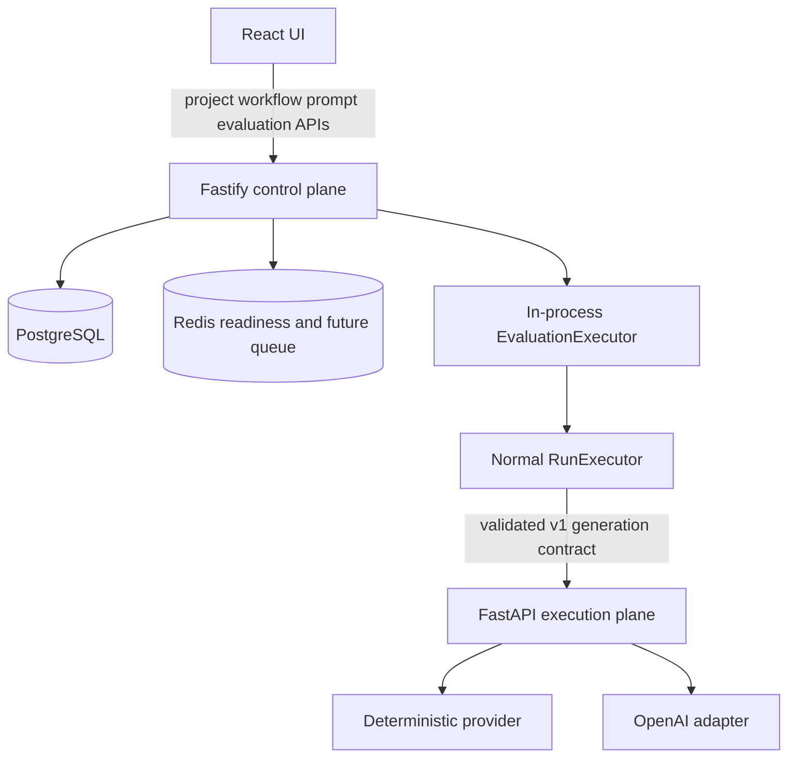

# AgentOps Studio Architecture

## Milestone 2 system

## Ownership boundaries

### Web

The browser provides project/workflow navigation, ReactFlow editing, prompt/version management, dataset/case management, evaluation launch and polling, metric dashboards, result traces, and version comparison. It calls only the Node API and never receives provider credentials.

### Node control plane

The control plane owns strict external validation, project isolation, graph validation/topological ordering, immutable WorkflowVersions and PromptVersions, normal Run execution, evaluation orchestration, deterministic evaluator selection, metric aggregation, and persistence. A PROMPT node may keep a legacy inline template or reference a project-scoped PromptVersion.

### Python execution plane

Python owns Pydantic request/response validation, provider selection, deterministic generation, OpenAI translation, and safe provider errors. It owns no project, workflow, prompt, evaluation, run, or trace persistence.

## Data model

- `projects`: isolation parent
- `workflows` and `workflow_versions`: mutable draft metadata and immutable graphs
- `prompts` and `prompt_versions`: registry metadata and immutable numbered templates
- `runs`, `node_runs`, and `trace_events`: normal execution and observability records
- `evaluation_datasets` and `evaluation_cases`: reusable inputs, expectations, and evaluator configuration
- `evaluation_runs`: one evaluation invocation, selected versions, status, and aggregate metrics
- `evaluation_case_results`: case outcome linked to the normal WorkflowRun that produced it

All nested reads verify the project parent. Prompt and workflow snapshots referenced by executions remain immutable.

## Validation and prompt resolution

The supported graph contains exactly one INPUT, at least one PROMPT, exactly one LLM, and exactly one OUTPUT, with a linear one-in/one-out topology. References, duplicates, self-edges, connectivity, reachability, node configuration, and cycles are validated. Kahn's algorithm uses a sorted zero-indegree queue for deterministic ordering.

Prompt templates permit identifier placeholders from an explicit allowlist; arbitrary expressions, member access, helpers, and unclosed expressions are rejected. When a PROMPT node references a PromptVersion, the API verifies project ownership when validating or versioning the workflow and resolves the immutable template during execution.

## Evaluation lifecycle

`POST /evaluation-runs` validates the WorkflowVersion, dataset, optional PromptVersion, and project boundaries, persists QUEUED state, and returns before background execution. The EvaluationExecutor marks the run RUNNING and processes every dataset case through the existing RunExecutor. It then evaluates the final output deterministically, links the case result to its WorkflowRun, and records traceability and safe failures.

Aggregate metrics are derived only from persisted case results: total/passed/failed cases, pass rate, average and p50/p95 latency, prompt/completion/total tokens. Comparisons require completed runs from the same dataset and calculate real deltas across their WorkflowVersions without replaying work.

## Reliability and security boundaries

The executor abstraction is isolated but in-process. Redis-backed durable queues, retries, leases, and recovery remain future hardening. External payloads are runtime validated; nested resources are project scoped; secrets and authorization headers are excluded from traces; raw stack traces are not returned; and Azure deployment uses GitHub OIDC with VM-scoped permission.

## Explicitly out of scope for Milestone 2

RAG/vector stores, HTTP tools/tool calling, branching/conditions, human approval, authentication/authorization, agent loops, and durable background workers.
