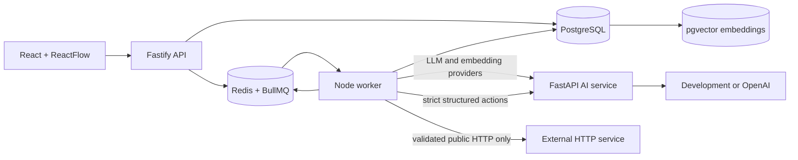

# AgentOps Studio

A production-style AI workflow and observability platform. Milestone 6 adds controlled, bounded agentic execution without changing the durable M3-M5 worker architecture.

## Implemented

- React + TypeScript project, workflow, prompt, evaluation, run, and approval UI
- ReactFlow DAG workflows with `CONDITION` TRUE/FALSE edges and explicit skipped branches
- Declarative `CONDITION`, safe structured `TRANSFORM`, and bounded `HTTP_REQUEST` nodes
- Project-scoped Knowledge Sources with idempotent TXT, PDF, and DOCX ingestion
- Deterministic chunking, provider-neutral development/OpenAI embeddings, and PostgreSQL `pgvector` storage
- A reusable `RETRIEVAL` node with ranked provenance, document filters, and cosine-similarity scores
- Controlled RAG prompt context, validated citations, inspectable source traces, and retrieval evaluation
- Controlled `AGENT` nodes with strict structured actions, explicit tool allowlists, hard step/tool/duration limits, and persisted timelines
- A typed Tool Registry that wraps existing retrieval, SSRF-safe HTTP, and deterministic transform capabilities
- Sensitive agent-tool approval using the existing non-blocking ApprovalRequest pause/resume lifecycle
- Durable AgentExecution, AgentStep, and ToolCall checkpoints with cancellation, recovery, safe retry feedback, and agent evaluators
- Mutable drafts with immutable WorkflowVersions and PromptVersions
- Project-scoped Fastify APIs and PostgreSQL persistence
- BullMQ queues persisted in Redis; the API never performs production execution
- Dedicated Node worker with four run consumers and two evaluation orchestrators
- Idempotent `run_id + node_id` NodeRuns, resumable completed-node checkpoints, and worker restart recovery
- Three attempts with bounded exponential backoff for transient AI/network failures
- 30-second provider timeout, 120-second workflow/evaluation timeout, and BullMQ stalled-job recovery
- Queued, running, and approval-wait cancellation with persisted reasons
- Persisted ApprovalRequests with approve/reject and non-blocking pause/resume
- DNS-aware SSRF blocking, same-origin redirect validation, 30-second maximum HTTP timeout, and 1 MiB default/5 MiB maximum response limits
- Project-scoped environment secret references; workflow versions store reference names only
- Evaluation cases using the same durable WorkflowRuns as interactive execution
- Structured traces, latency/token metrics, deterministic evaluators, and version comparisons
- Deterministic development AI provider and optional OpenAI adapter
- Docker Compose, CI, and Azure VM OIDC deployment

## Architecture



The API validates, persists, enqueues, and returns. The worker loads authoritative state from PostgreSQL and owns workflow/evaluation/ingestion orchestration. Python owns provider generation and embedding calls only. See [ARCHITECTURE.md](ARCHITECTURE.md), [ADRs](docs/adr/README.md), and the [Azure runbook](docs/AZURE_VM_DEPLOYMENT_GUIDE.md).

## Local development

Requirements: Node.js 20+, npm 10+, Python 3.11+, and Docker Compose.

```bash
npm install
npm run format:check
npm run lint
npm run typecheck
npm test
npm run build
docker compose up --build
```

Open `http://localhost:3000`; API health/readiness are on port `3001`. The AI service, worker, PostgreSQL, and Redis are private Compose services.

## Durable workflow flow

1. Create and version a linear workflow, optionally containing `HUMAN_APPROVAL`.
2. `POST /runs` persists `QUEUED`, writes `RUN_QUEUED`, adds a BullMQ job, and returns HTTP 202.
3. The worker claims the job, records the attempt, and executes from persisted NodeRuns.
4. At `HUMAN_APPROVAL`, it persists an ApprovalRequest, marks the node `WAITING` and run `WAITING_FOR_APPROVAL`, then finishes the job.
5. Approve creates a new resume job. Completed nodes, including the LLM call, are skipped. Reject cancels with `HUMAN_REJECTED`.
6. Cancellation is idempotent. Running work observes cancellation between nodes.
7. Evaluation orchestration is itself queued and each case creates a normal queued WorkflowRun.
8. A `CONDITION` selects exactly one labeled edge. The rejected subtree receives `SKIPPED` NodeRuns and `NODE_SKIPPED` traces.
9. `TRANSFORM` recursively maps constants and controlled `{{path.to.value}}` placeholders; it never evaluates code.
10. `HTTP_REQUEST` resolves DNS, blocks private/internal destinations, validates each same-origin redirect, streams a bounded response, and persists only safe response headers.

## Milestone 5 retrieval and RAG flow

1. Create a project-scoped Knowledge Source and upload a TXT, PDF, or DOCX file (maximum 5 MiB).
2. The existing worker consumes an ingestion job, extracts ordered pages, chunks deterministically, embeds in batches, and atomically replaces that document's chunks/vectors before marking it `READY`.
3. `RETRIEVAL` resolves a controlled query path, embeds the query with the source's exact provider/model, and searches only that project's compatible vectors with cosine similarity.
4. Ranked output preserves source, document, page, chunk, score, and a deterministic `retrieval_context` that labels document text as untrusted data.
5. PROMPT can consume `{{input}}` and `{{retrieval_context}}`; LLM output may cite `[[SOURCE:n]]` or `[[CITE:chunk-uuid]]`.
6. Citation validation rejects references outside the retrieved set and persists retrieved/cited provenance plus `CITATIONS_VALIDATED`.
7. `RETRIEVAL_HIT_AT_K`, `RETRIEVAL_RECALL_AT_K`, `RETRIEVAL_MRR`, and deterministic citation checks reuse normal evaluation WorkflowRuns.

## Milestone 6 controlled-agent flow

1. `AGENT` runs inside the existing BullMQ worker and calls the provider-neutral `/v1/agent/action` boundary for either a strict `TOOL_CALL` or `FINAL` action.
2. Only `retrieval`, `http_request`, and `transform` registry entries can be allowlisted. Returned names and arguments are schema-validated before dispatch.
3. Each AgentExecution, AgentStep, and ToolCall is persisted. Resume loads completed observations and never restarts at step one.
4. Sensitive calls create an `AGENT_TOOL` ApprovalRequest, persist redacted context, mark the run waiting, and return the worker job. Approval queues a resume; rejection becomes a structured observation so a bounded fallback can finish.
5. Step, tool-call, active-duration, and provider-reported token bounds terminate as `LIMIT_REACHED`. Token accounting is partial when a provider supplies no usage metadata.
6. Tool failures become bounded structured observations. Existing worker retries remain reserved for transient infrastructure/provider delivery failures.
7. The platform never asks for or stores hidden chain-of-thought; it persists only action type, selected tool, safe arguments, concise summary, result, status, and usage metadata.

## HTTP tool security and secrets

`HTTP_REQUEST` supports GET, POST, PUT, and PATCH. Redirects are manual, limited to three, and cross-origin redirects are rejected so credentials cannot move to another host. Every target is DNS-validated before the request. GET may participate in bounded transient retries. POST/PUT/PATCH are not retried unless `retry_non_idempotent` is enabled and `idempotency_key_header` is configured; this reduces duplicate side effects but does not guarantee exactly-once behavior.

Secrets are injected only into the worker through `TOOL_SECRETS_JSON`, shaped as `{"project-uuid":{"reference-name":"value"}}`. Graph headers contain only `{ "secret_ref": "reference-name" }`. Secret values are neither returned nor traced.

## API highlights

- `POST /api/v1/projects/:projectId/workflows/:workflowId/runs`
- `POST /api/v1/projects/:projectId/workflows/:workflowId/runs/:runId/cancel`
- `GET /api/v1/projects/:projectId/approvals`
- `POST /api/v1/projects/:projectId/approvals/:approvalId/approve`
- `POST /api/v1/projects/:projectId/approvals/:approvalId/reject`
- `/api/v1/projects/:projectId/evaluation-runs`
- `POST|GET /api/v1/projects/:projectId/knowledge-sources`
- `POST|GET /api/v1/projects/:projectId/knowledge-sources/:sourceId/documents`
- `GET /api/v1/projects/:projectId/workflows/:workflowId/runs/:runId/agent-executions`

## Known limitations

The demo has no production authentication, so approval decisions use `demo-reviewer`. Workflows reject merges, cycles, recursive agents, arbitrary tools, shell/code/filesystem access, and multi-agent spawning. Prompt injection from retrieved/tool content is reduced through instruction/data separation but cannot be eliminated. Provider token limits are enforced only when usage metadata is returned. HTTP checkpointing prevents replay after a persisted result but cannot guarantee exactly-once effects across the external-call crash window. Cancellation is cooperative, OpenAI execution requires credentials, and the single Azure VM is not highly available.

## Planned

- Production authentication and RBAC
- Multi-tenant and secrets-management hardening
- OpenTelemetry, metrics, alerts, backup/restore, TLS/domain, and a managed-cloud migration path
