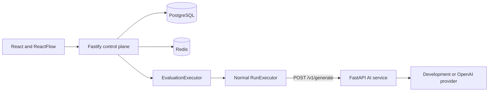

# AgentOps Studio

A production-style AI workflow and observability platform. Milestone 2 adds reusable, immutable prompt versions and deterministic evaluation while preserving the React -> Node control plane -> Python execution-plane boundary.

## Implemented

- React + TypeScript project, workflow, prompt registry, and evaluation UI
- ReactFlow `INPUT -> PROMPT -> LLM -> OUTPUT` editor
- Strict graph schemas, controlled `{{input}}` substitution, and prompt-reference validation
- Mutable workflow drafts and immutable WorkflowVersions
- Project-scoped APIs and PostgreSQL persistence
- Asynchronous workflow execution with NodeRun and TraceEvent records
- Reusable prompts with immutable, numbered PromptVersions
- Evaluation datasets and reusable cases
- Deterministic EXACT_MATCH, CONTAINS, NOT_CONTAINS, REGEX, and JSON_SCHEMA evaluators
- Evaluation runs that reuse normal WorkflowRuns for every case
- Persisted case results, pass rate, latency percentiles, token totals, and version comparisons
- Runtime-validated Node-to-Python generation contract
- Deterministic development provider and optional OpenAI adapter
- Docker Compose, readiness probes, CI, and Azure VM OIDC deployment

## Architecture



Node owns prompt/evaluation resources, graph validation, orchestration, metrics, and traces. Python owns provider-specific generation only. See [ARCHITECTURE.md](ARCHITECTURE.md) and [ADRs](docs/adr/README.md).

## Local development

Requirements: Node.js 20+, npm 10+, Python 3.11+, and Docker Compose.

```bash
npm install
npm run format:check
npm run lint
npm run typecheck
npm test
npm run build

cd apps/ai-service
python -m pip install -e ".[dev]"
ruff check .
ruff format --check .
mypy app tests
pytest
```

Run the complete stack:

```bash
docker compose up --build
```

Open `http://localhost:3000`. The API is at `http://localhost:3001`; readiness verifies PostgreSQL, Redis, and Python.

The deterministic provider is the default and requires no key. Set `AI_PROVIDER=openai`, `AI_OPENAI_API_KEY`, and `AI_OPENAI_MODEL` to use the OpenAI adapter. Never expose provider keys to the browser or commit them.

## Milestone 2 flow

1. Create a project and a reusable prompt.
2. add an immutable PromptVersion containing controlled placeholders such as `{{input}}`.
3. Select that version in a workflow PROMPT node, validate the graph, and create a WorkflowVersion.
4. Create an evaluation dataset and add cases with inputs, expected outputs, and deterministic evaluator rules.
5. Launch an evaluation against a WorkflowVersion and optional PromptVersion override.
6. Each case creates a normal WorkflowRun, preserving the same node trace and execution behavior as interactive runs.
7. Inspect pass/fail details, trace links, average and p50/p95 latency, token totals, and prompt-version comparisons.

## API highlights

- `/api/v1/projects/:projectId/prompts`
- `/api/v1/projects/:projectId/prompts/:promptId/versions`
- `/api/v1/projects/:projectId/evaluation-datasets`
- `/api/v1/projects/:projectId/evaluation-runs`
- `/api/v1/projects/:projectId/evaluation-comparisons`

## Known limitations

Evaluation and workflow executors are asynchronous but in-process, so queued work is not durable across an API crash. JSON Schema evaluation intentionally supports a deterministic subset. The OpenAI adapter is not live-tested without user credentials. The Azure demo is one VM over HTTP, not a highly available production deployment. RAG, tools, branching, human approval, authentication, and durable workers remain out of Milestone 2 scope.
