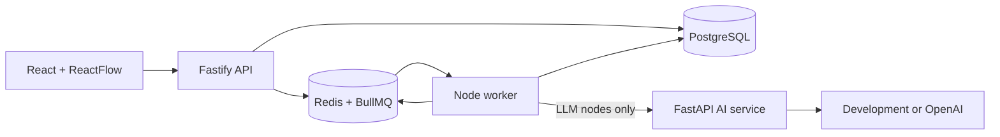

# AgentOps Studio

A production-style AI workflow and observability platform. Milestone 3 adds Redis-backed durable execution, a dedicated worker, bounded retries, cancellation, recovery, and persisted human approval.

## Implemented

- React + TypeScript project, workflow, prompt, evaluation, run, and approval UI
- ReactFlow `INPUT -> PROMPT -> LLM -> HUMAN_APPROVAL -> OUTPUT` linear workflows
- Mutable drafts with immutable WorkflowVersions and PromptVersions
- Project-scoped Fastify APIs and PostgreSQL persistence
- BullMQ queues persisted in Redis; the API never performs production execution
- Dedicated Node worker with four run consumers and two evaluation orchestrators
- Idempotent `run_id + node_id` NodeRuns, resumable completed-node checkpoints, and worker restart recovery
- Three attempts with bounded exponential backoff for transient AI/network failures
- 30-second provider timeout, 120-second workflow/evaluation timeout, and BullMQ stalled-job recovery
- Queued, running, and approval-wait cancellation with persisted reasons
- Persisted ApprovalRequests with approve/reject and non-blocking pause/resume
- Evaluation cases using the same durable WorkflowRuns as interactive execution
- Structured traces, latency/token metrics, deterministic evaluators, and version comparisons
- Deterministic development AI provider and optional OpenAI adapter
- Docker Compose, CI, and Azure VM OIDC deployment

## Architecture



The API validates, persists, enqueues, and returns. The worker loads authoritative state from PostgreSQL and owns workflow/evaluation orchestration. Python owns provider generation only. See [ARCHITECTURE.md](ARCHITECTURE.md), [ADRs](docs/adr/README.md), and the [Azure runbook](docs/AZURE_VM_DEPLOYMENT_GUIDE.md).

## Local development

Requirements: Node.js 20+, npm 10+, Python 3.11+, and Docker Compose.

```bash
npm install
npm run format:check
npm run lint
npm run typecheck
npm test
npm run build
docker compose up --build
```

Open `http://localhost:3000`; API health/readiness are on port `3001`. The AI service, worker, PostgreSQL, and Redis are private Compose services.

## Milestone 3 flow

1. Create and version a linear workflow, optionally containing `HUMAN_APPROVAL`.
2. `POST /runs` persists `QUEUED`, writes `RUN_QUEUED`, adds a BullMQ job, and returns HTTP 202.
3. The worker claims the job, records the attempt, and executes from persisted NodeRuns.
4. At `HUMAN_APPROVAL`, it persists an ApprovalRequest, marks the node `WAITING` and run `WAITING_FOR_APPROVAL`, then finishes the job.
5. Approve creates a new resume job. Completed nodes, including the LLM call, are skipped. Reject cancels with `HUMAN_REJECTED`.
6. Cancellation is idempotent. Running work observes cancellation between nodes.
7. Evaluation orchestration is itself queued and each case creates a normal queued WorkflowRun.

## API highlights

- `POST /api/v1/projects/:projectId/workflows/:workflowId/runs`
- `POST /api/v1/projects/:projectId/workflows/:workflowId/runs/:runId/cancel`
- `GET /api/v1/projects/:projectId/approvals`
- `POST /api/v1/projects/:projectId/approvals/:approvalId/approve`
- `POST /api/v1/projects/:projectId/approvals/:approvalId/reject`
- `/api/v1/projects/:projectId/evaluation-runs`

## Known limitations

The demo has no production authentication, so approval decisions deliberately use the label `demo-reviewer`, not a fabricated identity. A worker crash after a provider accepted a request but before its response was checkpointed can repeat that provider call; completed NodeRuns are never repeated. Cancellation is cooperative between nodes and cannot interrupt an already-running provider request. The Azure demo is one HTTP VM, not highly available. Conditions, transforms, HTTP tools, branching, retrieval/RAG, controlled agents, and production auth/hardening remain planned.
