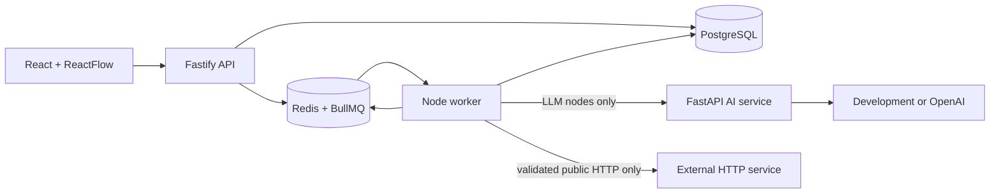

# AgentOps Studio

A production-style AI workflow and observability platform. Milestone 4 adds controlled DAG branches, deterministic conditions/transforms, and an SSRF-safe server-executed HTTP tool without changing the durable worker architecture.

## Implemented

- React + TypeScript project, workflow, prompt, evaluation, run, and approval UI
- ReactFlow DAG workflows with `CONDITION` TRUE/FALSE edges and explicit skipped branches
- Declarative `CONDITION`, safe structured `TRANSFORM`, and bounded `HTTP_REQUEST` nodes
- Mutable drafts with immutable WorkflowVersions and PromptVersions
- Project-scoped Fastify APIs and PostgreSQL persistence
- BullMQ queues persisted in Redis; the API never performs production execution
- Dedicated Node worker with four run consumers and two evaluation orchestrators
- Idempotent `run_id + node_id` NodeRuns, resumable completed-node checkpoints, and worker restart recovery
- Three attempts with bounded exponential backoff for transient AI/network failures
- 30-second provider timeout, 120-second workflow/evaluation timeout, and BullMQ stalled-job recovery
- Queued, running, and approval-wait cancellation with persisted reasons
- Persisted ApprovalRequests with approve/reject and non-blocking pause/resume
- DNS-aware SSRF blocking, same-origin redirect validation, 30-second maximum HTTP timeout, and 1 MiB default/5 MiB maximum response limits
- Project-scoped environment secret references; workflow versions store reference names only
- Evaluation cases using the same durable WorkflowRuns as interactive execution
- Structured traces, latency/token metrics, deterministic evaluators, and version comparisons
- Deterministic development AI provider and optional OpenAI adapter
- Docker Compose, CI, and Azure VM OIDC deployment

## Architecture



The API validates, persists, enqueues, and returns. The worker loads authoritative state from PostgreSQL and owns workflow/evaluation orchestration. Python owns provider generation only. See [ARCHITECTURE.md](ARCHITECTURE.md), [ADRs](docs/adr/README.md), and the [Azure runbook](docs/AZURE_VM_DEPLOYMENT_GUIDE.md).

## Local development

Requirements: Node.js 20+, npm 10+, Python 3.11+, and Docker Compose.

```bash
npm install
npm run format:check
npm run lint
npm run typecheck
npm test
npm run build
docker compose up --build
```

Open `http://localhost:3000`; API health/readiness are on port `3001`. The AI service, worker, PostgreSQL, and Redis are private Compose services.

## Milestone 4 flow

1. Create and version a linear workflow, optionally containing `HUMAN_APPROVAL`.
2. `POST /runs` persists `QUEUED`, writes `RUN_QUEUED`, adds a BullMQ job, and returns HTTP 202.
3. The worker claims the job, records the attempt, and executes from persisted NodeRuns.
4. At `HUMAN_APPROVAL`, it persists an ApprovalRequest, marks the node `WAITING` and run `WAITING_FOR_APPROVAL`, then finishes the job.
5. Approve creates a new resume job. Completed nodes, including the LLM call, are skipped. Reject cancels with `HUMAN_REJECTED`.
6. Cancellation is idempotent. Running work observes cancellation between nodes.
7. Evaluation orchestration is itself queued and each case creates a normal queued WorkflowRun.
8. A `CONDITION` selects exactly one labeled edge. The rejected subtree receives `SKIPPED` NodeRuns and `NODE_SKIPPED` traces.
9. `TRANSFORM` recursively maps constants and controlled `{{path.to.value}}` placeholders; it never evaluates code.
10. `HTTP_REQUEST` resolves DNS, blocks private/internal destinations, validates each same-origin redirect, streams a bounded response, and persists only safe response headers.

## HTTP tool security and secrets

`HTTP_REQUEST` supports GET, POST, PUT, and PATCH. Redirects are manual, limited to three, and cross-origin redirects are rejected so credentials cannot move to another host. Every target is DNS-validated before the request. GET may participate in bounded transient retries. POST/PUT/PATCH are not retried unless `retry_non_idempotent` is enabled and `idempotency_key_header` is configured; this reduces duplicate side effects but does not guarantee exactly-once behavior.

Secrets are injected only into the worker through `TOOL_SECRETS_JSON`, shaped as `{"project-uuid":{"reference-name":"value"}}`. Graph headers contain only `{ "secret_ref": "reference-name" }`. Secret values are neither returned nor traced.

## API highlights

- `POST /api/v1/projects/:projectId/workflows/:workflowId/runs`
- `POST /api/v1/projects/:projectId/workflows/:workflowId/runs/:runId/cancel`
- `GET /api/v1/projects/:projectId/approvals`
- `POST /api/v1/projects/:projectId/approvals/:approvalId/approve`
- `POST /api/v1/projects/:projectId/approvals/:approvalId/reject`
- `/api/v1/projects/:projectId/evaluation-runs`

## Known limitations

The demo has no production authentication, so approval decisions deliberately use the label `demo-reviewer`, not a fabricated identity. M4 rejects merge nodes (every non-INPUT node has one parent), loops, and cycles. DNS is validated immediately before each request, but the platform does not claim immunity from every DNS rebinding race or exactly-once external side effect. Cancellation is cooperative between nodes. The Azure demo is one HTTP VM, not highly available. Retrieval/RAG, controlled agents, and production auth/hardening remain planned.
