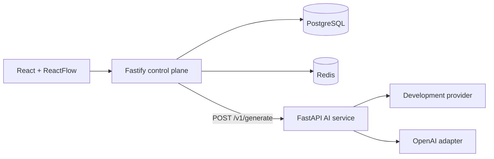

# AgentOps Studio

A production-style AI workflow and observability platform. Milestone 1 implements the first real, persisted workflow execution vertical slice while preserving the React → Node control plane → Python execution-plane boundary.

## Implemented

- React + TypeScript project and workflow UI
- ReactFlow INPUT → PROMPT → LLM → OUTPUT visual editor
- Strict node/edge schemas and controlled `{{input}}` substitution
- Deterministic graph validation, Kahn cycle detection, connectivity and reachability checks
- Mutable workflow drafts and immutable numbered workflow versions
- Project-scoped project/workflow/version/run/trace APIs
- Asynchronous 202 run creation with an isolated Node `RunExecutor`
- Persisted runs, node runs, trace events, final output, and safe failures
- Versioned, runtime-validated Node → Python `/v1/generate` contract
- Deterministic development provider (`DEV_RESPONSE: <prompt>`)
- OpenAI provider adapter selected by environment configuration
- TanStack Query run polling and a result/trace timeline
- PostgreSQL migrations, Redis, Docker Compose, health/readiness probes
- Strict TypeScript, ESLint, Prettier, Ruff, mypy, pytest, and GitHub Actions
- Azure VM deployment with OIDC-based automatic delivery

## Planned

- Prompt registry and reusable PromptVersions
- Evaluation datasets, evaluation runs, and version comparison
- Conditions and branching
- HTTP tools and tool calling
- Retrieval, embeddings, vector databases, and RAG
- Human approval
- Agent loops
- Cost/token dashboards and advanced observability
- Durable Redis-backed workers and interrupted-run recovery
- Authentication and authorization

## Architecture



The Node control plane owns graph validation, workflow/version/run persistence, orchestration, prompt rendering, and traces. Python owns only provider-specific generation. See [ARCHITECTURE.md](ARCHITECTURE.md) and [ADRs](docs/adr/README.md).

## Local development

Requirements: Node.js 20+, npm 10+, Python 3.11+, and Docker Compose.

```bash
npm install
npm run format:check
npm run lint
npm run typecheck
npm test
npm run build

cd apps/ai-service
python -m pip install -e ".[dev]"
ruff check .
ruff format --check .
mypy app tests
pytest
```

Run the complete stack:

```bash
docker compose up --build
```

Open `http://localhost:3000`. The API is at `http://localhost:3001`; readiness verifies PostgreSQL, Redis, and Python.

The default provider is deterministic and requires no key:

```env
AI_PROVIDER=development
```

To select the implemented OpenAI adapter:

```env
AI_PROVIDER=openai
AI_OPENAI_API_KEY=your-key
AI_OPENAI_MODEL=gpt-4o-mini
```

Never expose provider keys to the browser or commit them. Without an OpenAI key, the service falls back to the development provider.

## Milestone 1 execution

1. Create a project and workflow.
2. Add and connect INPUT, PROMPT, LLM, and OUTPUT.
3. Save, validate, and create an immutable version.
4. Enter runtime input and run it.
5. The API returns 202/QUEUED, executes in the background, calls Python for the LLM node, and persists node outputs and traces.
6. The UI polls until COMPLETED/FAILED and renders the result and timeline.

## Known limitations

The Milestone 1 executor is asynchronous but in-process, so it is not durable across a control-plane crash. The OpenAI adapter is implemented but was not live-tested without user credentials. The single Azure VM uses HTTP and remains a demo deployment, not a highly available production system.
