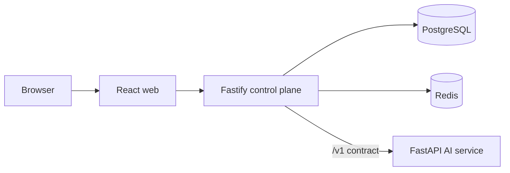

# AgentOps Studio

Reusable AI workflow, agent, and evaluation platform. This repository currently implements **Milestone 0: the production-oriented foundation**. Workflow execution and model invocation are planned, not simulated.

## Implemented

- React + TypeScript dashboard shell
- Fastify control-plane API with `/health` and dependency-aware `/ready`
- FastAPI AI execution service with `/health` and `/ready`
- Typed, runtime-validated Node-to-Python client
- PostgreSQL and Redis via Docker Compose
- Initial migration and automated Node/Python CI checks

## Architecture



The control plane owns product data and coordination. The execution plane owns model-specific behavior. See [ARCHITECTURE.md](ARCHITECTURE.md) and [ADRs](docs/adr/README.md).

## Local development

Requirements: Node.js 20+, npm 10+, Python 3.11+, and Docker Compose.

```bash
npm install
npm run lint
npm run typecheck
npm test
npm run build

cd apps/ai-service
python -m venv .venv
.venv/Scripts/pip install -e ".[dev]"  # Windows
.venv/Scripts/ruff check .
.venv/Scripts/mypy app tests
.venv/Scripts/pytest
```

Run the complete stack:

```bash
docker compose up --build
```

Open the web app at `http://localhost:3000`. The API is at `http://localhost:3001`; its readiness endpoint verifies PostgreSQL, Redis, and the AI service.

## Roadmap

- **Milestone 1 (next):** INPUT → PROMPT → LLM → OUTPUT workflow editor, validation, immutable versions, real execution, persistence, and traces.
- Later: evaluations, human approval, retrieval, HTTP tools, richer observability, and deployment hardening.

## Known limitations

Milestone 0 does not execute workflows or call model providers. Authentication, authorization, queue workers, and production secret management are also planned.
